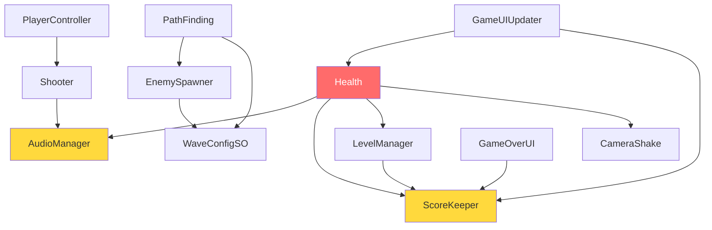

# 🔍 Đánh Giá Rủi Ro & Lỗi Tiềm Ẩn — Shooting Star

Phân tích toàn bộ **15 script** trong project. Đánh giá theo 4 mức độ:
- 🔴 **Critical** — Bug chắc chắn xảy ra trong runtime
- 🟠 **High** — Rủi ro cao khi mở rộng, có thể crash
- 🟡 **Medium** — Thiếu an toàn, gây khó bảo trì
- 🟢 **Low** — Code smell, nên cải thiện

---

## 1. 🔴 Critical — Bug Runtime

### 1.1 `NullReferenceException` hàng loạt do `FindObjectOfType`

| File | Dòng | Vấn đề |
|---|---|---|
| [Health.cs](file:///d:/Unity%20Projects/Shooting%20Star/ShootingStar/Assets/Scripts/Health.cs#L26-L29) | 26-29 | `Camera.main`, `FindObjectOfType<AudioManager>()`, `FindObjectOfType<ScoreKeeper>()`, `FindObjectOfType<LevelManager>()` — tất cả đều **không có null-check** |
| [Shooter.cs](file:///d:/Unity%20Projects/Shooting%20Star/ShootingStar/Assets/Scripts/Shooter.cs#L25) | 25 | `FindObjectOfType<AudioManager>()` không có null-check |
| [PathFinding.cs](file:///d:/Unity%20Projects/Shooting%20Star/ShootingStar/Assets/Scripts/PathFinding.cs#L12-L13) | 12-13 | `FindObjectOfType<EnemySpawner>()` → nếu EnemySpawner chưa được spawn hoặc bị destroy → crash |
| [GameUIUpdater.cs](file:///d:/Unity%20Projects/Shooting%20Star/ShootingStar/Assets/Scripts/GameUIUpdater.cs#L17) | 17 | `FindObjectOfType<ScoreKeeper>()` không null-check |
| [PlayerController.cs](file:///d:/Unity%20Projects/Shooting%20Star/ShootingStar/Assets/Scripts/PlayerController.cs#L34) | 34 | `Camera.main` có thể null nếu main camera chưa sẵn sàng |

**Kịch bản crash:** Bất kỳ khi nào một object bị destroy trước khi object phụ thuộc vào nó được khởi tạo, hoặc khi scene chuyển đổi và các singleton chưa sẵn sàng.

> [!CAUTION]
> Mọi lệnh `FindObjectOfType` đều có thể trả về `null`. Trong project hiện tại dùng ít nhất **7 chỗ** mà KHÔNG có null-check. Khi mở rộng thêm scene, thêm enemy, hoặc thay đổi thứ tự load → sẽ crash ngay lập tức.

---

### 1.2 `EnemySpawner` luôn spawn cùng 1 loại enemy

```csharp
// EnemySpawner.cs dòng 59
currentWave.GetEnemyPrefab(0) // ← Luôn dùng index 0!
```

Mặc dù `WaveConfigSO.enemyPrefabs` là mảng, nhưng `EnemySpawner` **luôn lấy enemyPrefabs[0]**. Kết quả:
- Mọi enemy trong cùng 1 wave đều giống nhau
- Nếu mảng `enemyPrefabs` rỗng → `IndexOutOfRangeException`
- Các slot prefab từ index 1 trở đi bị lãng phí hoàn toàn

---

### 1.3 `Health.Destroyed()` — Race condition khi Player chết

```csharp
// Health.cs dòng 62-73
private void Destroyed()
{
    if (isPlayer)
        levelManager.LoadGameOverScene(); // ← levelManager có thể null
    else if (!isPlayer)
        scoreKeeper.AddScore(scoreValue); // ← scoreKeeper có thể null
    
    Destroy(gameObject); // ← Destroy TRƯỚC khi coroutine WaitAndLoad kịp chạy
}
```

> [!WARNING]
> `Destroy(gameObject)` được gọi **ngay lập tức** sau `LoadGameOverScene()`. Nhưng `LoadGameOverScene()` sử dụng `StartCoroutine(WaitAndLoad(...))` với delay. Nếu player bị destroy, coroutine trên `LevelManager` vẫn chạy — nhưng nếu `LevelManager` là con của player hoặc cùng scene → coroutine có thể bị hủy bất ngờ.

---

### 1.4 `GameUIUpdater` — Crash khi Player chết

```csharp
// GameUIUpdater.cs dòng 21-25
void Update()
{
    healthSlider.value = playerHealth.GetHealth(); // ← playerHealth bị destroy → NullRef
    scoreText.text = scoreKeeper.GetScore().ToString("D9");
}
```

Khi player bị destroy (từ `Health.Destroyed()`), `playerHealth` reference trở thành null → crash **mỗi frame** trong `Update()`.

---

## 2. 🟠 High — Rủi Ro Khi Mở Rộng

### 2.1 Singleton Pattern thiếu thread-safety & có race condition

```csharp
// Singleton.cs dòng 13-14
if (instance == null)
    instance = FindFirstObjectByType<T>(); // Lazy init
```

**Vấn đề:**
- `FindFirstObjectByType` rất tốn hiệu năng (quét toàn scene) — được gọi mỗi khi truy cập `Instance` mà instance chưa set
- Nếu Singleton được gọi trước `Awake()` → lazy init chạy, nhưng sau đó `Awake()` lại gán `instance = this` → có thể tạo ra 2 instance tạm thời
- `DontDestroyOnLoad` chỉ áp dụng khi `transform.parent == null` — nếu Singleton là con của object khác → nó **sẽ bị destroy** khi chuyển scene, phá vỡ toàn bộ pattern

> [!IMPORTANT]
> `AudioManager` và `ScoreKeeper` đều kế thừa `Singleton<T>`, nhưng phần lớn code lại dùng `FindObjectOfType` thay vì `XXX.Instance`. Điều này **phá vỡ mục đích** của Singleton pattern.

| Vị trí dùng SAI (`FindObjectOfType`) | Nên dùng |
|---|---|
| `Health.cs:27` — `FindObjectOfType<AudioManager>()` | `AudioManager.Instance` |
| `Health.cs:28` — `FindObjectOfType<ScoreKeeper>()` | `ScoreKeeper.Instance` |
| `Shooter.cs:25` — `FindObjectOfType<AudioManager>()` | `AudioManager.Instance` |
| `GameUIUpdater.cs:17` — `FindObjectOfType<ScoreKeeper>()` | `ScoreKeeper.Instance` |
| `GameOverUI.cs:12` — `FindFirstObjectByType<ScoreKeeper>()` | `ScoreKeeper.Instance` |

---

### 2.2 Tight Coupling — Mọi thứ phụ thuộc nhau trực tiếp



`Health.cs` là script **nguy hiểm nhất** — nó phụ thuộc vào **4 class khác** (`AudioManager`, `CameraShake`, `ScoreKeeper`, `LevelManager`). Khi mở rộng:
- Thêm boss, thêm power-up, thêm shield → đều phải sửa `Health.cs`
- Không thể test `Health` độc lập
- Cần refactor sang **Event System** (UnityEvent hoặc C# events)

---

### 2.3 Không có Object Pooling — Memory leak tiềm ẩn

| Object | Tạo | Hủy | Tần suất |
|---|---|---|---|
| Projectile | `Shooter.FireContinuously()` | `Destroy(projectile, lifetime)` | Mỗi 0.2s |
| Enemy | `EnemySpawner.SpawnEnemy()` | `PathFinding` hoặc `Health` | Mỗi ~1s |
| ParticleSystem | `Health.HitParticleEffect()` | `Destroy(particles, duration)` | Mỗi lần trúng |
| AudioSource | `AudioSource.PlayClipAtPoint()` | Tự hủy | Mỗi lần bắn/trúng |

> [!WARNING]
> Mỗi `Instantiate` + `Destroy` gây **GC allocation**. Trong game bắn súng với hàng trăm viên đạn/giây, điều này sẽ gây **frame spike** (GC stutter) rõ rệt trên mobile. Nên dùng **Object Pooling** cho projectiles, enemies, và particles.

---

### 2.4 `CameraShake` — Chồng coroutine khi bị hit liên tục

```csharp
// CameraShake.cs dòng 16-18
public void Play()
{
    StartCoroutine(ShakeCoroutine()); // ← Mỗi lần hit = 1 coroutine mới!
}
```

Nếu player bị hit 5 lần liên tục → 5 coroutine shake chạy **đồng thời**, camera bị giật lung tung và `initialPosition` bị ghi đè sai.

**Fix cần thiết:** Dừng coroutine cũ trước khi bắt đầu mới, hoặc dùng counter.

---

### 2.5 `BackgroundScroller` — Float overflow sau thời gian dài

```csharp
// BackgroundScroller.cs dòng 17
offset += scrollSpeed * Time.deltaTime; // ← offset tăng mãi, không bao giờ reset
```

Sau vài giờ chơi, `offset` sẽ đạt giá trị rất lớn → mất precision của `float` → background giật hoặc đứng yên. Cần `offset %= 1f` để giữ giá trị trong khoảng `[0, 1]`.

---

## 3. 🟡 Medium — Code Safety & Maintainability

### 3.1 `LevelManager` dùng hardcoded scene name

```csharp
StartCoroutine(WaitAndLoad("GameScene", delayBeforeLoading));
StartCoroutine(WaitAndLoad("GameOverScene", delayBeforeLoading));
StartCoroutine(WaitAndLoad("MenuScene", delayBeforeLoading));
```

> [!WARNING]
> Nếu đổi tên scene trong Build Settings mà quên sửa code → crash im lặng (scene không load được). Nên dùng `enum` hoặc `const string` tập trung tại 1 chỗ, hoặc dùng scene index.

---

### 3.2 `LevelManager` không phải Singleton nhưng nên là

`LevelManager` được dùng khắp nơi (từ `Health.cs`) nhưng **không phải Singleton** và không có `DontDestroyOnLoad`. Khi chuyển scene, `LevelManager` sẽ bị destroy → các reference đến nó trở thành null.

---

### 3.3 `WaveConfigSO.GetEnemyPrefab()` không có bounds check

```csharp
public GameObject GetEnemyPrefab(int index)
{
    return enemyPrefabs[index]; // ← Không check index < Length
}
```

Nếu gọi với index ngoài phạm vi → `IndexOutOfRangeException`.

---

### 3.4 `PathFinding` — So sánh Vector3 bằng `==`

```csharp
// PathFinding.cs dòng 31
if (transform.position == targetPosition) // ← Float comparison!
```

So sánh `==` giữa 2 `Vector3` dùng ngưỡng rất nhỏ (`1e-5`) nhưng vẫn có thể không bao giờ đúng nếu `MoveTowards` với `moveDelta` lớn bước qua mục tiêu. Trong thực tế `MoveTowards` đảm bảo không vượt quá target nên hiện tại OK, nhưng nếu thay đổi logic di chuyển → bug tiềm ẩn.

---

### 3.5 `Shooter.cs` — Import `NUnit.Framework` không cần thiết

```csharp
using NUnit.Framework; // ← Test framework import trong production code!
```

Đây là test framework, không nên có trong code production. Có thể gây build error trên một số platform.

---

## 4. 🟢 Low — Code Smell & Cải Thiện

### 4.1 `ScoreKeeper.AddScore()` — Clamp không cần thiết

```csharp
currentScore = Mathf.Clamp(currentScore, 0, int.MaxValue);
```
`int.MaxValue` là giá trị max của int rồi, clamp này chỉ hữu ích cho min = 0 (tránh điểm âm). Nên viết rõ ràng hơn:
```csharp
currentScore = Mathf.Max(currentScore, 0);
```

### 4.2 `Health.Destroyed()` — Điều kiện thừa

```csharp
if (isPlayer) { ... }
else if (!isPlayer) { ... } // ← `else` đã đủ, không cần `if (!isPlayer)`
```

### 4.3 Không có namespace

Tất cả 15 class đều ở **global namespace**. Khi mở rộng dự án hoặc import asset store package → rất dễ bị trùng tên class (ví dụ: `Health`, `DamageDealer` rất phổ biến).

### 4.4 Thiếu `[RequireComponent]` attribute

- `PlayerController` cần `Shooter` → nên thêm `[RequireComponent(typeof(Shooter))]`
- `BackgroundScroller` cần `Renderer` → nên thêm `[RequireComponent(typeof(Renderer))]`
- `CameraShake` nên gắn vào Camera → `[RequireComponent(typeof(Camera))]`

### 4.5 `Health.cs` hardcode `healthPoints` property không có setter

Không có cách nào để power-up hoặc heal item phục hồi máu cho player. Nếu muốn thêm tính năng heal → phải sửa class.

---

## 5. 📋 Tổng Hợp & Ưu Tiên Sửa

| # | Mức độ | Vấn đề | File | Khẩn cấp |
|---|---|---|---|---|
| 1 | 🔴 | `GameUIUpdater` crash khi player chết | GameUIUpdater.cs | Ngay |
| 2 | 🔴 | Không null-check cho `FindObjectOfType` (7 chỗ) | Health, Shooter, PathFinding... | Ngay |
| 3 | 🔴 | `EnemySpawner` luôn spawn `enemyPrefabs[0]` | EnemySpawner.cs | Ngay |
| 4 | 🟠 | Singleton tồn tại nhưng không được sử dụng đúng | Health, Shooter, GameUIUpdater | Sớm |
| 5 | 🟠 | Thiếu Object Pooling cho projectiles/enemies | Shooter, EnemySpawner | Khi tối ưu |
| 6 | 🟠 | `CameraShake` chồng coroutine | CameraShake.cs | Sớm |
| 7 | 🟠 | `BackgroundScroller` float overflow | BackgroundScroller.cs | Sớm |
| 8 | 🟡 | Hardcoded scene names | LevelManager.cs | Khi mở rộng |
| 9 | 🟡 | `LevelManager` không phải Singleton | LevelManager.cs | Khi mở rộng |
| 10 | 🟡 | Import `NUnit.Framework` thừa | Shooter.cs | Ngay (dễ fix) |
| 11 | 🟢 | Thiếu namespace cho tất cả class | Tất cả | Khi mở rộng |
| 12 | 🟢 | Thiếu `[RequireComponent]` | PlayerController, BackgroundScroller | Bất kỳ lúc nào |

---

## 6. 🏗️ Khuyến Nghị Kiến Trúc Khi Mở Rộng

### Nếu thêm tính năng (boss, power-up, multiplayer, leaderboard):

1. **Event System** — Thay thế tight coupling bằng `UnityEvent` hoặc C# `event`/`Action`:
   ```csharp
   // Thay vì Health gọi trực tiếp scoreKeeper, levelManager...
   public event Action<int> OnDamaged;
   public event Action OnDeath;
   ```

2. **Object Pooling** — Dùng `ObjectPool<T>` (Unity 2021+) cho projectiles, enemies, particles

3. **Dependency Injection** — Tối thiểu là dùng `[SerializeField]` inject thay vì `FindObjectOfType`

4. **State Machine** — Cho enemy AI khi thêm boss với nhiều phase

5. **ScriptableObject Events** — Cho việc giao tiếp giữa các hệ thống mà không cần reference trực tiếp
