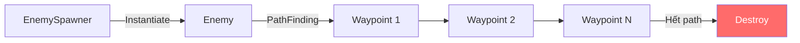
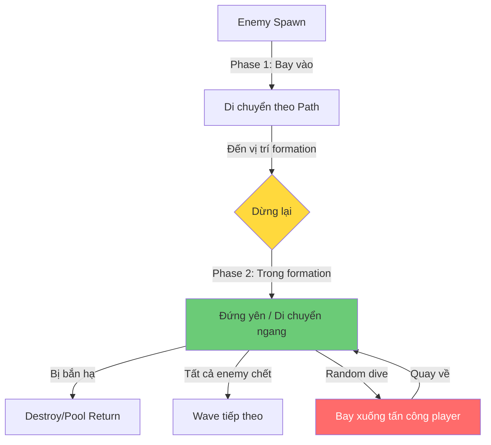
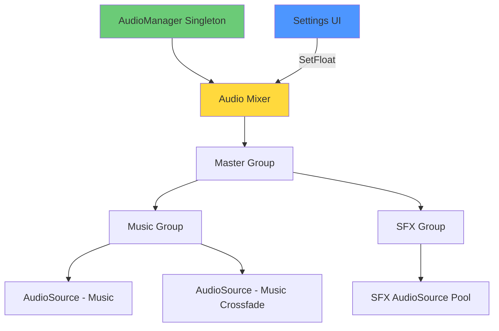
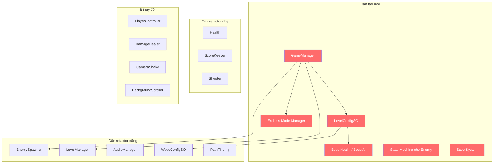

# 🔍 Tổng Hợp Rủi Ro & Phân Tích Tính Năng Tương Lai — Shooting Star

> Phân tích dựa trên **15 script** hiện tại (phiên bản đã cập nhật, 20/04/2026).
> Bạn đã sửa khá nhiều so với lần review trước — `Health.cs`, `ScoreKeeper.cs`, `DamageDealer.cs`, `GameUIUpdater.cs`, `GameOverUI.cs`, `LevelManager.cs`, `PathFinding.cs` đều đã cải thiện đáng kể. Tài liệu này phản ánh **trạng thái code hiện tại**.

---

# Phần 0 — Tối Ưu & Rủi Ro Hiện Tại

## 0a. `FindObjectOfType` vs `FindFirstObjectByType` vs Singleton Instance

### Hiện trạng code

| File | Dòng | Cách gọi hiện tại | Gọi lúc nào? |
|---|---|---|---|
| [Health.cs](file:///d:/Unity%20Projects/Shooting%20Star/ShootingStar/Assets/Scripts/Health.cs#L47-L52) | 47-52 | `AudioManager.Instance` ✅, `ScoreKeeper.Instance` ✅, `FindFirstObjectByType<LevelManager>()` ⚠️ | `Start()` — 1 lần |
| [Shooter.cs](file:///d:/Unity%20Projects/Shooting%20Star/ShootingStar/Assets/Scripts/Shooter.cs#L25) | 25 | `AudioManager.Instance` ✅ | `Start()` — 1 lần |
| [PathFinding.cs](file:///d:/Unity%20Projects/Shooting%20Star/ShootingStar/Assets/Scripts/PathFinding.cs#L12) | 12 | `FindFirstObjectByType<EnemySpawner>()` ⚠️ | `Start()` — 1 lần |
| [GameUIUpdater.cs](file:///d:/Unity%20Projects/Shooting%20Star/ShootingStar/Assets/Scripts/GameUIUpdater.cs#L17) | 17 | `ScoreKeeper.Instance` ✅ | `OnEnable()` — 1 lần |
| [GameOverUI.cs](file:///d:/Unity%20Projects/Shooting%20Star/ShootingStar/Assets/Scripts/GameOverUI.cs#L13) | 13 | `ScoreKeeper.Instance` ✅ | `Awake()` — 1 lần |
| [Singleton.cs](file:///d:/Unity%20Projects/Shooting%20Star/ShootingStar/Assets/Scripts/Singleton.cs#L14) | 14 | `FindFirstObjectByType<T>()` trong lazy getter | Khi `Instance` được truy cập lần đầu |

### So sánh 3 cách tiếp cận

```
┌─────────────────────────┬──────────────────┬─────────────────────┬──────────────────────┐
│                         │ FindObjectOfType │ FindFirstObjectByType│ Singleton.Instance   │
│                         │ (ĐÃ BỎ ✅)       │                     │                      │
├─────────────────────────┼──────────────────┼─────────────────────┼──────────────────────┤
│ Tốc độ                  │ Chậm nhất        │ Nhanh hơn ~2x       │ Nhanh nhất (O(1))    │
│                         │ (quét toàn scene │ (dừng ở kết quả     │ (truy cập biến       │
│                         │  + sort)         │  đầu tiên)          │  static trực tiếp)   │
├─────────────────────────┼──────────────────┼─────────────────────┼──────────────────────┤
│ GC Allocation           │ Có               │ Ít hơn              │ Không                │
├─────────────────────────┼──────────────────┼─────────────────────┼──────────────────────┤
│ Gọi trong Update()?     │ ❌ TUYỆT ĐỐI    │ ❌ TUYỆT ĐỐI       │ ✅ OK                │
│                         │    KHÔNG          │    KHÔNG             │                      │
├─────────────────────────┼──────────────────┼─────────────────────┼──────────────────────┤
│ Gọi trong Start()/      │ ⚠️ Chấp nhận    │ ✅ OK               │ ✅ Tốt nhất          │
│ Awake()?                │    được           │                     │                      │
├─────────────────────────┼──────────────────┼─────────────────────┼──────────────────────┤
│ Null safety             │ Có thể null      │ Có thể null         │ Có thể null          │
│                         │                  │                     │ (nhưng lazy init     │
│                         │                  │                     │  giảm rủi ro)        │
├─────────────────────────┼──────────────────┼─────────────────────┼──────────────────────┤
│ Dùng cho class nào?     │ Bất kỳ           │ Bất kỳ              │ Chỉ class kế thừa   │
│                         │                  │                     │ Singleton<T>         │
└─────────────────────────┴──────────────────┴─────────────────────┴──────────────────────┘
```

### Khuyến nghị cụ thể

**Nguyên tắc:** Nếu class đã là Singleton → luôn dùng `XXX.Instance`. Nếu class KHÔNG phải Singleton → dùng `FindFirstObjectByType` trong `Start()`/`Awake()` hoặc inject qua `[SerializeField]`.

| Vị trí | Hiện tại | Nên chuyển sang | Lý do |
|---|---|---|---|
| `Health.cs:52` — `FindFirstObjectByType<LevelManager>()` | ⚠️ | **Giữ nguyên hoặc chuyển LevelManager thành Singleton** | LevelManager hiện KHÔNG phải Singleton — nếu bạn sẽ mở rộng ra 8+ màn chơi, LevelManager cần tồn tại xuyên suốt → nên thành Singleton |
| `PathFinding.cs:12` — `FindFirstObjectByType<EnemySpawner>()` | ⚠️ | **Inject qua spawner khi Instantiate** (truyền WaveConfig trực tiếp) | Xem giải thích bên dưới |
| `Singleton.cs:14` — lazy `FindFirstObjectByType<T>()` | ✅ OK | Giữ nguyên | Đây là fallback hợp lý, chỉ chạy 1 lần rồi cache |

**Về PathFinding + EnemySpawner:**

Hiện tại `PathFinding.Start()` phải tự đi tìm `EnemySpawner` rồi hỏi `GetWaveConfig()`. Đây là **coupling ngược** — enemy phải biết về spawner. Khi mở rộng (8 màn, endless mode, nhiều spawner), cách tiếp cận này sẽ:
- Crash nếu có 2+ EnemySpawner (lấy sai config)
- Enemy không biết nó thuộc wave nào

> [!TIP]
> **Giải pháp tốt hơn:** Khi `EnemySpawner` instantiate enemy, truyền `WaveConfigSO` trực tiếp vào `PathFinding` qua một public method `Init(WaveConfigSO config)`. Không cần FindFirstObjectByType nữa.
> ```csharp
> // Trong EnemySpawner, sau khi Instantiate:
> PathFinding pathFinding = enemy.GetComponent<PathFinding>();
> pathFinding.Init(currentWave);
>
> // Trong PathFinding:
> public void Init(WaveConfigSO config) {
>     waveConfig = config;
>     waypoints = config.GetWaypoints();
>     transform.position = config.GetStartingWaypoint().position;
> }
> ```

---

## 0b. Object Pooling — Đạn & Enemy

### Tại sao cần Object Pooling?

Mỗi lần gọi `Instantiate()` và `Destroy()`, Unity phải:
1. Cấp phát bộ nhớ (memory allocation)
2. Gọi constructor, `Awake()`, `Start()`
3. Khi destroy → đánh dấu cho GC (Garbage Collector)
4. GC chạy → **frame spike** (game giật 1 khung hình)

```
Không có pooling:
Frame 1: Instantiate 🔫💥 → Bình thường
Frame 2: Instantiate 🔫💥 → Bình thường  
...
Frame 50: GC chạy! ⚡ → GIẬT 16ms → player thấy lag

Có pooling:
Frame 1: pool.Get() → trả object có sẵn → 0 allocation
Frame 2: pool.Release() → tắt object, trả về pool → 0 GC
...
Frame 50: Vẫn mượt ✅
```

### Nên áp dụng cho gì?

| Object | Tần suất tạo/hủy | Ưu tiên Pool | Ghi chú |
|---|---|---|---|
| **Projectile (đạn player)** | Mỗi 0.2s | 🔴 **RẤT CẦN** | Nhiều nhất trong game |
| **Projectile (đạn enemy)** | Mỗi enemy mỗi ~0.5-1s | 🔴 **RẤT CẦN** | Nhân với số enemy = rất nhiều |
| **Enemy** | Mỗi wave ~1s | 🟠 **NÊN CÓ** | Đặc biệt quan trọng cho Endless Mode |
| **ParticleSystem (hit effect)** | Mỗi lần trúng đạn | 🟡 **Có thể** | Ít hơn đạn nhưng vẫn tạo GC |
| **AudioSource (PlayClipAtPoint)** | Mỗi phát bắn/trúng | 🟡 **Có thể** | `PlayClipAtPoint` tạo temp GameObject mỗi lần |
| **Thiên thạch** (tính năng mới) | Tùy map | 🟠 **NÊN CÓ** | Nếu trôi qua liên tục |

### Có áp dụng cho Enemy waves không?

**CÓ, đặc biệt khi bạn mở rộng.**

Hiện tại enemy bay qua rồi bị `Destroy` ở cuối path. Nếu thêm:
- 8 màn × 4-5 waves × 5-10 enemy = **160-400 enemy** mỗi lần chơi
- Endless mode → **vô hạn enemy**

Không pool → GC spike liên tục. Với pool:
```
Lần chơi đầu: Tạo ~20 enemy vào pool
Suốt phần còn lại: Lấy từ pool, reset vị trí, reset HP → 0 allocation
```

> [!IMPORTANT]
> Unity 2021+ có sẵn `UnityEngine.Pool.ObjectPool<T>`. Không cần tự viết.
> ```csharp
> using UnityEngine.Pool;
>
> // Khai báo
> ObjectPool<GameObject> bulletPool = new ObjectPool<GameObject>(
>     createFunc: () => Instantiate(prefab),
>     actionOnGet: (obj) => obj.SetActive(true),
>     actionOnRelease: (obj) => obj.SetActive(false),
>     actionOnDestroy: (obj) => Destroy(obj),
>     defaultCapacity: 20,
>     maxSize: 100
> );
>
> // Sử dụng
> GameObject bullet = bulletPool.Get();      // Thay Instantiate
> bulletPool.Release(bullet);                // Thay Destroy
> ```

### Rủi ro khi triển khai Object Pooling

| Rủi ro | Mô tả | Cách tránh |
|---|---|---|
| **Object "bẩn"** | Object lấy từ pool vẫn giữ state cũ (HP, velocity, rotation) | Luôn reset trong `OnGet` callback hoặc `OnEnable()` |
| **Pool quá lớn** | Tạo sẵn 500 object nhưng chỉ dùng 20 → lãng phí RAM | Dùng `defaultCapacity` nhỏ, để pool tự mở rộng |
| **Quên Release** | Object không bao giờ trả về pool → pool cạn, Instantiate lại | Cần đảm bảo mọi code path đều Release (kể cả khi enemy bay ra khỏi màn hình) |
| **Event subscriber rò rỉ** | Object pool chỉ `SetActive(false)`, không Destroy → các event listener vẫn tồn tại | Unsubscribe trong `OnDisable()` (bạn ĐÃ LÀM trong GameUIUpdater ✅) |

---

## 0c. C# Events & Observer Pattern — Hướng Dẫn Chi Tiết

### Bạn đã bắt đầu dùng rồi! ✅

Code hiện tại **đã có event**:
- [Health.cs:21](file:///d:/Unity%20Projects/Shooting%20Star/ShootingStar/Assets/Scripts/Health.cs#L21) → `public event Action<int> HealthChanged`
- [ScoreKeeper.cs:9](file:///d:/Unity%20Projects/Shooting%20Star/ShootingStar/Assets/Scripts/ScoreKeeper.cs#L9) → `public event Action<int> ScoreChanged`
- [GameUIUpdater.cs:27-55](file:///d:/Unity%20Projects/Shooting%20Star/ShootingStar/Assets/Scripts/GameUIUpdater.cs#L27-L55) → Subscribe/Unsubscribe đúng pattern ✅

Đây là nền tảng rất tốt. Bây giờ tôi sẽ giải thích sâu hơn để bạn có thể mở rộng.

### Event là gì? — Giải thích bằng ví dụ thực tế

```
KHÔNG CÓ EVENT (coupling chặt):
┌──────────┐     gọi trực tiếp     ┌──────────┐
│  Health   │ ───────────────────► │  UI       │
│           │ ───────────────────► │  Audio    │
│           │ ───────────────────► │  Score    │
│           │ ───────────────────► │  Camera   │
└──────────┘                       └──────────┘
Health phải BIẾT về UI, Audio, Score, Camera.
Thêm 1 hệ thống = sửa Health.

CÓ EVENT (coupling lỏng):
┌──────────┐     phát event        ┌──────────┐
│          │ ─── "Tôi bị hit!" ──►│  UI       │ (tự lắng nghe)
│  Health  │          │           │  Audio    │ (tự lắng nghe)
│          │          │           │  Score    │ (tự lắng nghe)
│          │          │           │  Camera   │ (tự lắng nghe)
└──────────┘          │           │ ★VFX mới  │ (tự lắng nghe - KHÔNG SỬA Health)
                      │           └──────────┘
Health chỉ phát sóng. KHÔNG CẦN BIẾT ai đang nghe.
Thêm 1 hệ thống = chỉ thêm code mới, KHÔNG sửa code cũ.
```

### 3 loại Event trong Unity — Khi nào dùng gì?

#### 1️⃣ C# `event Action` (bạn đang dùng)

```csharp
// ═══ BÊN PHÁT (Publisher) ═══
public class Health : MonoBehaviour
{
    public event Action<int> HealthChanged;       // Khai báo event
    public event Action OnDeath;                  // Event không tham số

    void TakeDamage(int damage)
    {
        healthPoints -= damage;
        HealthChanged?.Invoke(healthPoints);      // Phát event

        if (healthPoints <= 0)
            OnDeath?.Invoke();                    // Phát event chết
    }
}

// ═══ BÊN NGHE (Subscriber) ═══
public class GameUIUpdater : MonoBehaviour
{
    void OnEnable()
    {
        playerHealth.HealthChanged += RefreshHealthUI;   // Đăng ký
        playerHealth.OnDeath += HandlePlayerDeath;
    }

    void OnDisable()
    {
        playerHealth.HealthChanged -= RefreshHealthUI;   // HỦY đăng ký (BẮT BUỘC!)
        playerHealth.OnDeath -= HandlePlayerDeath;
    }

    void RefreshHealthUI(int hp) { /* cập nhật slider */ }
    void HandlePlayerDeath() { /* ẩn UI, hiện animation chết */ }
}
```

**Ưu điểm:** Nhanh, nhẹ, type-safe, C# thuần.
**Nhược điểm:** Subscriber cần reference đến Publisher (phải `playerHealth.HealthChanged += ...`).

#### 2️⃣ `UnityEvent` (kéo thả trong Inspector)

```csharp
using UnityEngine.Events;

public class Health : MonoBehaviour
{
    [SerializeField] private UnityEvent<int> onHealthChanged;  // Hiện trong Inspector!
    [SerializeField] private UnityEvent onDeath;

    void TakeDamage(int damage)
    {
        healthPoints -= damage;
        onHealthChanged?.Invoke(healthPoints);
        if (healthPoints <= 0)
            onDeath?.Invoke();
    }
}
// Sau đó kéo thả object vào Inspector để assign listener — không cần code subscribe!
```

**Ưu điểm:** Designer/non-coder có thể gắn listener trong Inspector.
**Nhược điểm:** Chậm hơn C# event ~5x, khó debug, dễ bị mất reference khi refactor.

#### 3️⃣ ScriptableObject Event Channel (nâng cao — cho game lớn)

```csharp
// ═══ Event Channel (ScriptableObject) ═══
[CreateAssetMenu(menuName = "Events/Int Event Channel")]
public class IntEventChannelSO : ScriptableObject
{
    public event Action<int> OnEventRaised;
    public void RaiseEvent(int value) => OnEventRaised?.Invoke(value);
}

// ═══ BÊN PHÁT ═══
public class Health : MonoBehaviour
{
    [SerializeField] private IntEventChannelSO healthChangedChannel; // Assign trong Inspector
    void TakeDamage(int dmg)
    {
        healthPoints -= dmg;
        healthChangedChannel.RaiseEvent(healthPoints);
    }
}

// ═══ BÊN NGHE ═══
public class HealthUI : MonoBehaviour
{
    [SerializeField] private IntEventChannelSO healthChangedChannel; // Cùng 1 SO asset
    void OnEnable() => healthChangedChannel.OnEventRaised += UpdateSlider;
    void OnDisable() => healthChangedChannel.OnEventRaised -= UpdateSlider;
    void UpdateSlider(int hp) { /* ... */ }
}
```

**Ưu điểm:** Publisher và Subscriber KHÔNG CẦN biết nhau. Giao tiếp qua 1 asset trung gian. Rất mạnh cho game lớn.
**Nhược điểm:** Nhiều file hơn, phức tạp hơn cho game nhỏ.

### Khuyến nghị cho Shooting Star

| Quy mô | Dùng gì? |
|---|---|
| Hiện tại (15 script) | **C# `event Action`** — đúng rồi, tiếp tục mở rộng ✅ |
| Khi có 8 màn + boss + endless | Vẫn `event Action` nhưng cần **thêm nhiều event hơn** (xem bảng dưới) |
| Khi game thực sự phức tạp (50+ script) | Xem xét SO Event Channel cho các event cross-scene |

### Những event bạn NÊN thêm khi mở rộng

| Event | Phát từ | Ai nghe? | Mục đích |
|---|---|---|---|
| `Health.OnDeath` | Health.cs | LevelManager, VFX, Audio, Camera | Thay thế việc Health gọi trực tiếp `levelManager.LoadGameOverScene()` |
| `EnemySpawner.OnWaveCompleted` | EnemySpawner | LevelManager, UI, AudioManager | Biết khi nào wave kết thúc để chuyển nhạc, hiện UI "Wave Clear!" |
| `EnemySpawner.OnAllWavesCompleted` | EnemySpawner | LevelManager | Biết khi nào hết tất cả waves để chuyển màn hoặc vào boss |
| `LevelManager.OnLevelChanged` | LevelManager | UI, AudioManager, BackgroundScroller | Đổi nhạc, đổi background cho mỗi màn |
| `Boss.OnPhaseChanged` | Boss (mới) | AudioManager, VFX, UI | Đổi nhạc khi boss chuyển phase |
| `GameManager.OnGamePaused` | GameManager (mới) | Tất cả | Pause/Resume game cho Settings menu |

> [!TIP]
> **Quy tắc vàng:** Nếu code ở class A cần gọi method ở class B, hãy tự hỏi: *"Class A có cần BIẾT class B tồn tại không?"* Nếu không → dùng event.

### Rủi ro khi dùng Event

| Rủi ro | Mô tả | Bạn đã tránh chưa? |
|---|---|---|
| **Memory leak** — quên unsubscribe | Object bị destroy nhưng event vẫn giữ reference → GC không thu hồi được | ✅ Đã unsubscribe trong `OnDisable()` ở GameUIUpdater |
| **Null event** — gọi Invoke khi không ai nghe | `HealthChanged.Invoke(x)` mà không có subscriber → NullRef | ✅ Đã dùng `if (HealthChanged != null)` — hoặc có thể dùng `?.Invoke()` ngắn hơn |
| **Execution order** — event fire trước khi subscriber sẵn sàng | `Awake()` fire event nhưng subscriber chưa `OnEnable()` | ⚠️ Cần cẩn thận thứ tự initialization |
| **Debug khó** — không biết ai đang nghe | Event là "vô hình" trong Inspector | Dùng `Debug.Log` hoặc viết Editor tool hiển thị subscriber |

---

## Rủi ro còn lại trong code hiện tại

### R1. `Shooter.cs` dòng 64 — `audioManager` có thể null

```csharp
audioManager.PlayShootingSFX(); // Dòng 64 - KHÔNG CÓ null-check!
```

Trong khi `Health.cs:167` đã check `if (audioManager != null)` ✅, nhưng `Shooter.cs:64` lại **không check**. Nếu `AudioManager` chưa sẵn sàng → crash mỗi lần bắn.

### R2. `Shooter.cs` dòng 2 — Import `NUnit.Framework` thừa

```csharp
using NUnit.Framework; // Test framework trong production code!
```

Nên xóa. Có thể gây build error trên một số platform (WebGL, iOS).

### R3. `CameraShake` — Vẫn chồng coroutine

Vấn đề từ lần review trước **chưa được sửa**. Nếu player bị hit liên tục → nhiều `ShakeCoroutine` chạy đồng thời → camera giật bất thường.

### R4. `BackgroundScroller` — Float overflow

`offset` tăng mãi không reset. Vẫn chưa sửa.

### R5. `EnemySpawner:59` — Vẫn luôn spawn `enemyPrefabs[0]`

```csharp
currentWave.GetEnemyPrefab(0) // Luôn index 0
```

Với 8 màn × 4-5 waves, đây sẽ là vấn đề lớn vì bạn cần spawn nhiều loại enemy khác nhau.

### R6. `WaveConfigSO.GetEnemyPrefab()` — Không có bounds check

```csharp
public GameObject GetEnemyPrefab(int index)
{
    return enemyPrefabs[index]; // Không check index < Length
}
```

---

# Phần 1 — Highest Score

### Hiện trạng

Bạn ĐÃ thêm `highScore` trong [ScoreKeeper.cs](file:///d:/Unity%20Projects/Shooting%20Star/ShootingStar/Assets/Scripts/ScoreKeeper.cs#L7) ✅ và [GameOverUI.cs](file:///d:/Unity%20Projects/Shooting%20Star/ShootingStar/Assets/Scripts/GameOverUI.cs#L19) hiển thị nó ✅.

### Rủi ro & Thiếu sót

| # | Vấn đề | Mức độ | Chi tiết |
|---|---|---|---|
| 1 | **High score mất khi tắt game** | 🔴 Critical | `highScore` chỉ là biến trong RAM. Tắt game = mất. Cần lưu bằng `PlayerPrefs` hoặc file JSON |
| 2 | **High score reset khi reload scene** | 🟠 | `ScoreKeeper` là Singleton với `DontDestroyOnLoad` nên OK trong session — nhưng mất khi tắt app |
| 3 | **Không có UI highlight khi phá kỷ lục** | 🟡 | Nên có animation/VFX "NEW HIGH SCORE!" trên GameOverUI |
| 4 | **Endless mode cần leaderboard riêng** | 🟡 | Story mode score và Endless mode score nên tách biệt |

### Giải pháp lưu High Score

```csharp
// Đơn giản nhất — PlayerPrefs
public void SaveHighScore()
{
    PlayerPrefs.SetInt("HighScore", highScore);
    PlayerPrefs.Save();
}

public void LoadHighScore()
{
    highScore = PlayerPrefs.GetInt("HighScore", 0);
}

// Gọi LoadHighScore() trong Awake()
// Gọi SaveHighScore() khi game over hoặc khi highScore thay đổi
```

> [!NOTE]
> `PlayerPrefs` lưu vào Registry (Windows) hoặc plist (macOS). Đủ dùng cho game nhỏ. Nếu cần lưu nhiều data hơn (per-level score, unlock status các màn) → dùng JSON file.

---

# Phần 2 — Enemy Dừng Lại & Thiên Thạch

### Hiện trạng hệ thống Wave



Enemy hiện tại: Spawn → bay theo path → hết path → bị destroy. **Không bao giờ dừng.**

### Để enemy dừng lại thành hàng (kiểu Chicken Invaders)

Cần thay đổi kiến trúc `PathFinding` đáng kể:



### Rủi ro khi triển khai Formation System

| # | Rủi ro | Chi tiết |
|---|---|---|
| 1 | **PathFinding phải refactor hoàn toàn** | Hiện tại PathFinding chỉ biết "đi từ A→B→C→destroy". Cần thêm state: `MovingToFormation → InFormation → Diving → ReturningToFormation` |
| 2 | **Cần Formation Manager** | Ai quản lý vị trí các ô trong formation? Cần 1 class mới quản lý grid/slot. Khi 1 enemy chết, slot trống |
| 3 | **WaveConfigSO thiếu data** | Cần thêm: vị trí formation cho mỗi enemy, pattern di chuyển khi ở formation, tỷ lệ dive attack |
| 4 | **Enemy cần State Machine** | `PathFinding` hiện tại quá đơn giản cho behavior phức tạp. Cần `EnemyStateMachine` với các state: `EnterFormation`, `Idle`, `Dive`, `Return` |
| 5 | **Detect "wave clear"** | Khi nào tất cả enemy trong wave đã chết? Cần tracking. Hiện tại không có mechanism này |
| 6 | **Object Pooling bắt buộc** | Enemy dừng lại = tồn tại lâu hơn = nhiều enemy cùng lúc trên màn hình. Không pool → performance drop |

### Thiên thạch

| # | Rủi ro | Chi tiết |
|---|---|---|
| 1 | **Thiên thạch là enemy hay obstacle?** | Nếu là enemy → dùng Health, có thể bắn vỡ. Nếu là obstacle → cần logic riêng (không thể phá, chỉ né) |
| 2 | **Collision với enemy** | Thiên thạch có va chạm với enemy không? Nếu có → cần layer collision matrix cẩn thận |
| 3 | **Spawn system riêng** | Thiên thạch không thuộc wave system → cần spawner riêng, hoặc thêm "obstacle" category trong WaveConfigSO |
| 4 | **Kích thước & rotation** | Thiên thạch to, xoay → cần `PolygonCollider2D` chính xác hơn, tốn performance hơn box/circle collider |

---

# Phần 3 — Cài Đặt & Âm Lượng

### Hiện trạng AudioManager

```csharp
// AudioManager.cs hiện tại
AudioSource.PlayClipAtPoint(clip, Camera.main.transform.position, volume);
```

**Vấn đề lớn:** `PlayClipAtPoint` tạo 1 temporary GameObject mỗi lần gọi, và **KHÔNG thể điều chỉnh volume sau khi tạo**. Nghĩa là:
- Slider volume trong Settings **không thể ảnh hưởng** đến SFX đang phát
- Không thể pause/stop SFX
- Mỗi lần bắn = 1 new GameObject → không pool-friendly

### Rủi ro khi thêm Settings

| # | Rủi ro | Mức độ | Chi tiết |
|---|---|---|---|
| 1 | **AudioManager cần refactor hoàn toàn** | 🔴 | `PlayClipAtPoint` không hỗ trợ dynamic volume. Cần chuyển sang `AudioSource` component trực tiếp hoặc dùng **Audio Mixer** |
| 2 | **Phân biệt Music vs SFX** | 🟠 | Hiện tại chỉ có SFX. Khi thêm nhạc cho mỗi wave/boss → cần tách: Music AudioSource (loop, crossfade) + SFX AudioSource (one-shot) |
| 3 | **Lưu settings** | 🟠 | Volume setting cần lưu vĩnh viễn (PlayerPrefs) và load khi mở game |
| 4 | **Pause game khi mở Settings** | 🟠 | Cần `Time.timeScale = 0` khi mở menu → tất cả coroutine dùng `WaitForSeconds` sẽ bị pause → OK. Nhưng UI animation cũng bị pause → cần `WaitForSecondsRealtime` cho UI |
| 5 | **Audio Mixer Groups** | 🟡 | Unity Audio Mixer cho phép: Master → Music / SFX / UI, điều chỉnh volume từng group bằng 1 slider. Đây là cách chuẩn |

### Kiến trúc Audio được khuyến nghị



```csharp
// Ý tưởng cho AudioManager mới
public class AudioManager : Singleton<AudioManager>
{
    [SerializeField] private AudioMixer audioMixer;
    [SerializeField] private AudioSource musicSource;
    [SerializeField] private AudioSource musicCrossfadeSource;
    
    public void SetMusicVolume(float volume01)
    {
        // AudioMixer dùng dB: 0dB = full, -80dB = mute
        float dB = Mathf.Log10(Mathf.Max(volume01, 0.0001f)) * 20f;
        audioMixer.SetFloat("MusicVolume", dB);
        PlayerPrefs.SetFloat("MusicVolume", volume01);
    }
    
    public void SetSFXVolume(float volume01)
    {
        float dB = Mathf.Log10(Mathf.Max(volume01, 0.0001f)) * 20f;
        audioMixer.SetFloat("SFXVolume", dB);
        PlayerPrefs.SetFloat("SFXVolume", volume01);
    }
    
    // Crossfade giữa 2 track nhạc (cho chuyển wave/boss)
    public IEnumerator CrossfadeMusic(AudioClip newClip, float duration = 1f) { /* ... */ }
}
```

---

# Phần 4 — Hệ Thống 8 Màn Chơi + Boss + Endless Mode

## Đây là thay đổi LỚN NHẤT — ảnh hưởng gần như MỌI script hiện tại

### 4.0 Tổng quan kiến trúc cần thiết



### 4.1 Data Architecture — ScriptableObject Hierarchy

Hiện tại bạn chỉ có `WaveConfigSO`. Để hỗ trợ 8 màn, cần thêm tầng trên:

```
LevelConfigSO (MỚI)                    ← Đại diện cho 1 màn chơi
├── levelNumber: int                    ← Màn 1, 2, 3...
├── levelName: string                   ← "Nebula Assault", "Asteroid Field"...
├── backgroundSprite/Material           ← Background riêng mỗi màn
├── waveConfigs: WaveConfigSO[]         ← 4-5 wave configs
├── bossConfig: BossConfigSO (MỚI)     ← Config cho boss cuối màn
├── waveMusicClip: AudioClip            ← Nhạc cho waves thường
├── bossMusicClip: AudioClip            ← Nhạc cho boss
├── hasAsteroids: bool                  ← Có thiên thạch không?
├── asteroidConfig: AsteroidConfigSO    ← Nếu có
└── difficulty: float                   ← Hệ số HP/speed/fire rate

WaveConfigSO (SỬA)                     ← Đại diện cho 1 wave trong 1 màn
├── (giữ nguyên các field hiện tại)
├── formationType: enum                 ← Fly-through / Formation / Mixed
├── formationPositions: Vector2[]       ← Vị trí dừng nếu dùng formation
└── waveMusic: AudioClip               ← (tuỳ chọn) nhạc riêng cho wave

BossConfigSO (MỚI)                     ← Config cho boss
├── bossPrefab: GameObject
├── bossHP: int
├── phases: BossPhase[]                 ← Mỗi phase có attack pattern khác nhau
├── bossMusic: AudioClip
└── scoreValue: int
```

### 4a. Mỗi Wave & Boss có nhạc riêng — Rủi ro

| # | Rủi ro | Mức độ | Chi tiết |
|---|---|---|---|
| 1 | **AudioManager hiện tại không hỗ trợ music** | 🔴 | Chỉ có SFX, không có nhạc nền, không có crossfade |
| 2 | **8 màn × (5 wave + 1 boss) = 48 AudioClip** | 🟠 | Rất nhiều clip. Nếu load tất cả vào RAM → lãng phí. Cần `Addressables` hoặc lazy load |
| 3 | **Transition giữa các track** | 🟠 | Cắt nhạc đột ngột rất khó chịu. Cần crossfade 1-2 giây |
| 4 | **Boss music trigger khi nào?** | 🟡 | Khi boss spawn? Khi wave cuối clear? Cần event `OnBossPhaseStart` |
| 5 | **Quên tắt nhạc khi player chết** | 🟡 | Nhạc boss vẫn phát trên GameOver screen? Cần event `OnPlayerDeath` → fade out music |

### 4b. Endless Mode — Rủi ro

| # | Rủi ro | Mức độ | Chi tiết |
|---|---|---|---|
| 1 | **Memory leak theo thời gian** | 🔴 | Endless = chơi vô hạn. Nếu không có Object Pool → memory tăng dần → crash |
| 2 | **Difficulty scaling** | 🟠 | Random wave từ màn 1-8 nhưng giữ nguyên stats? Sẽ quá dễ sau khi player quen. Cần nhân hệ số difficulty theo thời gian |
| 3 | **Random nhưng fair** | 🟠 | `Random.Range` thuần có thể cho ra 5 boss liên tiếp hoặc 10 wave dễ liên tiếp. Cần weighted random hoặc shuffle bag |
| 4 | **High score riêng cho Endless** | 🟡 | Score Endless không nên gộp với Score story mode |
| 5 | **Khi nào xuất hiện boss trong Endless?** | 🟡 | Sau mỗi X waves? Sau mỗi Y phút? Random? Cần gameplay design rõ |
| 6 | **EnemySpawner không hỗ trợ dynamic wave** | 🟠 | Hiện tại `waveConfigs` là mảng cố định trong Inspector. Endless cần inject wave configs lúc runtime |

### 4c. Mô hình tiến trình: Balatro vs Chicken Invaders

Đây là quyết định **thiết kế game quan trọng nhất**. Để tôi phân tích ưu/nhược:

```
┌─────────────────────────┬────────────────────────────┬────────────────────────────┐
│                         │ 🃏 KIỂU BALATRO             │ 🐔 KIỂU CHICKEN INVADERS   │
│                         │ (Roguelike run)             │ (Level select)              │
├─────────────────────────┼────────────────────────────┼────────────────────────────┤
│ Cách chơi               │ Chạy thông màn 1→8         │ Chọn màn tùy thích          │
│                         │ Chết = về màn 1             │ Chết = chơi lại màn đó      │
├─────────────────────────┼────────────────────────────┼────────────────────────────┤
│ Replayability           │ ⭐⭐⭐⭐⭐ Rất cao           │ ⭐⭐⭐ Trung bình             │
│                         │ Mỗi run khác nhau          │ Sau khi clear hết = hết     │
├─────────────────────────┼────────────────────────────┼────────────────────────────┤
│ Độ khó cảm nhận        │ Khó hơn (mất hết progress) │ Dễ hơn (giữ progress)       │
├─────────────────────────┼────────────────────────────┼────────────────────────────┤
│ Code phức tạp           │ ⭐⭐⭐ Trung bình            │ ⭐⭐⭐⭐ Cao hơn              │
│                         │ Chỉ cần quản lý 1 "run"    │ Cần Save/Load cho mỗi màn   │
├─────────────────────────┼────────────────────────────┼────────────────────────────┤
│ Save system             │ Đơn giản: high score       │ Phức tạp: unlock status,    │
│                         │                            │ stars, per-level best score  │
├─────────────────────────┼────────────────────────────┼────────────────────────────┤
│ Kết hợp Endless Mode    │ Tự nhiên! Endless = run    │ Endless là mode riêng,       │
│                         │ không giới hạn              │ unlock sau khi clear hết     │
├─────────────────────────┼────────────────────────────┼────────────────────────────┤
│ LevelManager thay đổi   │ Vừa phải: chỉ cần          │ Nhiều: cần level select      │
│                         │ nextLevel counter           │ screen, unlock system,       │
│                         │                            │ save/load per level          │
├─────────────────────────┼────────────────────────────┼────────────────────────────┤
│ Phù hợp với game nào?   │ Game ngắn mỗi run          │ Game mỗi màn dài, có        │
│                         │ (5-30 phút cho 8 màn)       │ replay value từng màn       │
└─────────────────────────┴────────────────────────────┴────────────────────────────┘
```

### Rủi ro cho mỗi hướng:

#### 🃏 Nếu chọn Balatro (Roguelike run):

| # | Rủi ro | Chi tiết |
|---|---|---|
| 1 | **Frustration cao** | Chết ở màn 7/8 mà bắt đầu lại từ 1 → player bỏ game nếu không có hệ thống "meta-progression" (ví dụ: unlock vũ khí mới vĩnh viễn) |
| 2 | **Cần dynamic difficulty** | Nếu 8 màn cố định thứ tự, player sẽ thuộc lòng pattern → nhàm chán. Cần random element (enemy pattern, power-up, ...) |
| 3 | **Không cần Save phức tạp** | ✅ Ưu điểm — chỉ cần lưu: current run progress (trong RAM), high score (PlayerPrefs) |
| 4 | **Game flow đơn giản hơn** | Menu → Game (màn 1→8) → Win/Lose → Menu. Không cần level select screen |

#### 🐔 Nếu chọn Chicken Invaders (Level select):

| # | Rủi ro | Chi tiết |
|---|---|---|
| 1 | **Save system phức tạp** | Cần lưu: từng màn đã unlock chưa, best score mỗi màn, stars/rating, tổng progress |
| 2 | **Level Select UI** | Cần thiết kế thêm 1 scene/panel mới với 8 nút level, lock/unlock visual, stars |
| 3 | **Balancing khó hơn** | Player có thể skip lại màn dễ → farm score, hoặc replay cùng 1 màn mãi |
| 4 | **Endless mode unlock logic** | Unlock sau khi clear tất cả 8 màn? Hay unlock sớm hơn? |

#### 💡 Lựa chọn thứ 3: Hybrid

Nhiều game hiện đại kết hợp cả hai:
- **Story Mode:** Chạy thông 1→8 (Balatro style), NHƯNG sau khi clear lần đầu, unlock **Level Select** cho phép chơi lại từng màn
- **Endless Mode:** Unlock sau khi clear story mode lần đầu

Cách này cho best of both worlds: cảm giác hành trình lần đầu + replay value sau đó.

---

# Tổng Hợp — Ma Trận Rủi Ro × Tính Năng

Bảng dưới cho thấy mỗi tính năng mới sẽ **gặp phải rủi ro gì** từ code hiện tại:

| Script hiện tại | Rủi ro hiện tại | High Score | Formation | Thiên Thạch | Settings | 8 Màn | Boss | Endless |
|---|---|:---:|:---:|:---:|:---:|:---:|:---:|:---:|
| **EnemySpawner** — luôn spawn `[0]`, không track wave completion | 🔴 | | ❌ Phải refactor | ❌ Cần spawner riêng | | ❌ Refactor nặng | ❌ Cần boss spawn | ❌ Dynamic waves |
| **PathFinding** — chỉ fly-through, coupling với EnemySpawner | 🟠 | | ❌ Cần state machine | | | ❌ Nhiều pattern | ❌ Boss movement | ❌ Random pattern |
| **AudioManager** — chỉ SFX, dùng PlayClipAtPoint | 🟠 | | | | ❌ Refactor toàn bộ | ❌ Music per level | ❌ Boss music | ❌ Random music |
| **LevelManager** — không Singleton, 3 scene cố định | 🟡 | | | | | ❌ Refactor nặng | ❌ Boss → next level | ❌ Endless flow |
| **WaveConfigSO** — thiếu formation data | 🟡 | | ❌ Thêm fields | ❌ Thêm obstacle | | ❌ Thêm LevelConfig | ❌ Boss config | ❌ Reusable |
| **ScoreKeeper** — mất highscore khi tắt game | 🟠 | ❌ Cần persist | | | | | | ❌ Score riêng |
| **Health** — gọi trực tiếp levelManager | 🟡 | | | | | ⚠️ OnDeath event | ⚠️ Boss multi-phase | |
| **Shooter** — null audioManager, NUnit import | 🟡 | | | | | | | |
| **CameraShake** — chồng coroutine | 🟡 | | | | | | ❌ Boss shake mạnh | |
| **BackgroundScroller** — float overflow | 🟡 | | | | | ❌ BG per level | | ❌ Long play |
| **Singleton** — DontDestroyOnLoad edge case | 🟡 | | | | | ⚠️ Nhiều scene hơn | | |

**Chú thích:** ❌ = Bị ảnh hưởng trực tiếp, cần sửa. ⚠️ = Có thể ảnh hưởng.

---

# Thứ Tự Ưu Tiên Đề Xuất

Dựa trên phân tích trên, nếu bạn muốn implementation hiệu quả nhất, thứ tự nên là:

```
Phase 0: Sửa bug & tối ưu nền tảng (TRƯỚC KHI thêm tính năng)
├── 0.1 Sửa Shooter.cs: null-check audioManager, xóa NUnit import
├── 0.2 Sửa CameraShake: chống chồng coroutine
├── 0.3 Sửa BackgroundScroller: reset offset
├── 0.4 Sửa EnemySpawner: spawn đúng enemy từ mảng (không luôn [0])
├── 0.5 PathFinding: nhận WaveConfig qua Init() thay vì FindFirstObjectByType
└── 0.6 LevelManager: chuyển thành Singleton

Phase 1: Nền tảng kiến trúc mới
├── 1.1 Tạo LevelConfigSO (data cho mỗi màn)
├── 1.2 Refactor AudioManager (Music + SFX + AudioMixer)
├── 1.3 Thêm Object Pooling (đạn trước, enemy sau)
├── 1.4 Thêm event OnDeath cho Health
├── 1.5 High Score persist (PlayerPrefs)
└── 1.6 Quyết định Balatro vs Chicken vs Hybrid

Phase 2: Tính năng gameplay
├── 2.1 Settings menu (volume controls)
├── 2.2 Hệ thống 8 màn (LevelManager + LevelConfigSO)
├── 2.3 Formation system (enemy dừng thành hàng)
├── 2.4 Thiên thạch
└── 2.5 Boss system (BossConfigSO + Boss AI)

Phase 3: Endless Mode
├── 3.1 Endless Mode Manager
├── 3.2 Random weighted wave/boss selection
├── 3.3 Difficulty scaling
└── 3.4 Endless leaderboard riêng
```

> [!IMPORTANT]
> Phase 0 và Phase 1 LÀ NỀN TẢNG. Nếu bỏ qua và nhảy thẳng vào Phase 2, bạn sẽ phải refactor lại nhiều lần, tốn gấp đôi thời gian.
