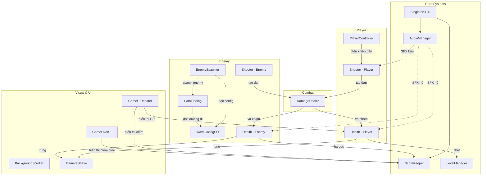
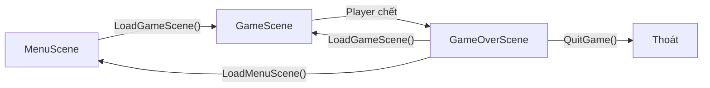
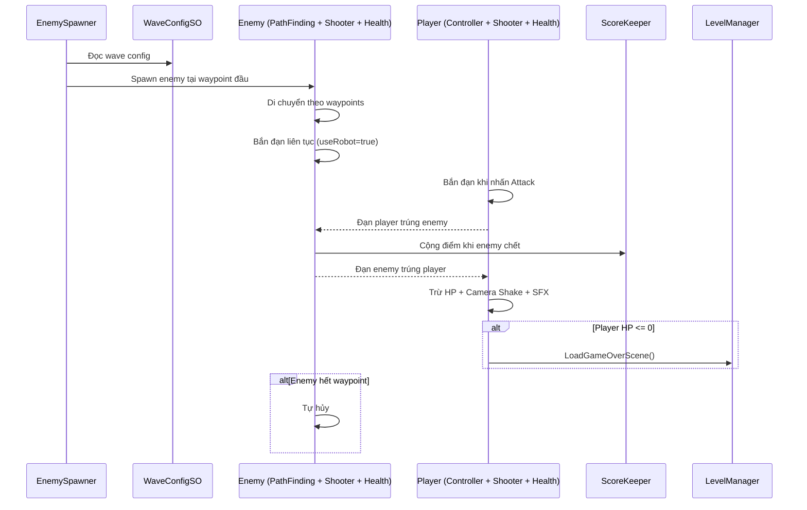

# 🚀 Phân Tích Dự Án: Shooting Star

## 1. Tổng Quan Dự Án

**Shooting Star** là một game **bắn máy bay 2D (Space Shooter)** được phát triển trên **Unity** sử dụng **Universal Render Pipeline (URP)**. Người chơi điều khiển một tàu vũ trụ, bắn hạ kẻ thù xuất hiện theo từng đợt (wave), tích lũy điểm số.

### Thông tin cơ bản
| Thuộc tính | Chi tiết |
|---|---|
| **Engine** | Unity (URP) |
| **Thể loại** | 2D Space Shooter |
| **Input System** | Unity New Input System |
| **UI** | TextMesh Pro |
| **Số scene** | 3 (Menu, Game, GameOver) |
| **Số script C#** | 15 files |
| **Số prefabs** | 7+ (Player, Enemy, Projectiles, etc.) |

---

## 2. Cấu Trúc Thư Mục

```
Assets/
├── Material/          → 2 materials (Background, Explosion)
├── Paths & Waves/     → 3 Paths (đường đi enemy) + 3 Wave configs
├── Prefabs/           → Player, Enemy, Explosion, AudioManager, LevelManager, ScoreKeeper
│   └── Projectile/    → Player Projectile, Enemy Projectile
├── SFX/               → 12 thư mục âm thanh (Laser, Explosion, Engine, ...)
├── Scenes/            → MenuScene, GameScene, GameOverScene
├── Scripts/           → 15 C# scripts
├── Sprites/           → Player (7 tàu), Enemies (17 loại), Projectiles, Backgrounds, Effects
└── Settings/          → URP render settings
```

---

## 3. Kiến Trúc Hệ Thống



---

## 4. Phân Tích Chi Tiết Từng Script

### 4.1 `Singleton<T>` — Nền tảng Singleton Pattern
> [file link](file:///d:/Unity%20Projects/Shooting%20Star/ShootingStar/Assets/Scripts/Singleton.cs)

**Mục đích:** Cung cấp pattern Singleton generic cho các manager cần tồn tại xuyên suốt các scene.

**Cơ chế hoạt động:**
- Sử dụng **generic constraint** `where T : Singleton<T>` để tái sử dụng cho nhiều class
- **Lazy Initialization**: Nếu `instance` là `null`, tự động tìm trong scene bằng `FindFirstObjectByType<T>()`
- **DontDestroyOnLoad**: Nếu object không có parent, sẽ tồn tại qua các scene
- Nếu phát hiện duplicate instance → tự hủy bản thân

**Được sử dụng bởi:** `AudioManager`, `ScoreKeeper`

---

### 4.2 `PlayerController` — Điều Khiển Người Chơi
> [file link](file:///d:/Unity%20Projects/Shooting%20Star/ShootingStar/Assets/Scripts/PlayerController.cs)

**Mục đích:** Xử lý input di chuyển và bắn của người chơi.

**Cơ chế hoạt động:**
- Sử dụng **Unity New Input System** (`InputSystem.actions`)
- Di chuyển 4 hướng với tốc độ `moveSpeed` (mặc định 10)
- **Giới hạn vùng di chuyển** dựa trên viewport camera + padding có thể tùy chỉnh
- Truyền trạng thái `isFiring` sang component `Shooter` khi người chơi nhấn nút Attack

**Luồng xử lý:**
```
Input (Move) → MovePlayer() → Clamp position trong viewport
Input (Attack) → FireShooter() → Set Shooter.isFiring
```

---

### 4.3 `Shooter` — Hệ Thống Bắn
> [file link](file:///d:/Unity%20Projects/Shooting%20Star/ShootingStar/Assets/Scripts/Shooter.cs)

**Mục đích:** Xử lý logic bắn đạn cho cả Player và Enemy.

**Cơ chế hoạt động:**
- **Dùng chung cho Player và Enemy** thông qua flag `useRobot`
- Enemy tự động bắn (`useRobot = true` → `isFiring = true` ngay từ Start)
- Sử dụng **Coroutine** `FireContinuously()` để bắn liên tục
- Tốc độ bắn có **random variance** giữa `firingRate ± fireRateVariance`
- Clamp thời gian bắn tối thiểu = `minimumFiringRate`
- Đạn bay theo hướng `transform.up` (hướng local "lên" của object)
- Tự hủy đạn sau `projectileLifetime` giây

**Các tham số:**
| Tham số | Mặc định | Mô tả |
|---|---|---|
| `projectileSpeed` | 10 | Tốc độ đạn |
| `projectileLifetime` | 5s | Thời gian sống của đạn |
| `firingRate` | 0.2s | Thời gian giữa mỗi lần bắn |
| `fireRateVariance` | 0 | Độ biến thiên tốc độ bắn |
| `minimumFiringRate` | 0.1s | Tốc độ bắn tối thiểu |

---

### 4.4 `DamageDealer` — Xử Lý Sát Thương
> [file link](file:///d:/Unity%20Projects/Shooting%20Star/ShootingStar/Assets/Scripts/DamageDealer.cs)

**Mục đích:** Gắn vào đạn (projectile) để mang giá trị sát thương.

**Cơ chế:** Rất đơn giản — chứa `damage` value và tự hủy khi `Hit()` được gọi.

---

### 4.5 `Health` — Hệ Thống Máu
> [file link](file:///d:/Unity%20Projects/Shooting%20Star/ShootingStar/Assets/Scripts/Health.cs)

**Mục đích:** Quản lý HP cho cả Player và Enemy.

**Cơ chế hoạt động:**
- Khi va chạm (`OnTriggerEnter2D`) với `DamageDealer` → trừ máu
- Tạo **particle effect** khi bị trúng đạn
- Kích hoạt **camera shake** nếu `applyCameraShake = true`
- Phát **SFX nổ** qua `AudioManager`
- Khi HP ≤ 0:
  - **Player chết** → Load GameOver scene
  - **Enemy chết** → Cộng điểm vào `ScoreKeeper`
  - Hủy GameObject

---

### 4.6 `WaveConfigSO` — Cấu Hình Đợt Tấn Công
> [file link](file:///d:/Unity%20Projects/Shooting%20Star/ShootingStar/Assets/Scripts/WaveConfigSO.cs)

**Mục đích:** ScriptableObject cấu hình cho mỗi wave enemy.

**Dữ liệu chứa:**
| Field | Mô tả |
|---|---|
| `pathPrefab` | Prefab chứa các waypoint (đường đi) |
| `enemyMoveSpeed` | Tốc độ di chuyển enemy (mặc định 5) |
| `enemyPrefabs[]` | Mảng các enemy prefab |
| `timeBetweenEnemySpawns` | Thời gian giữa mỗi enemy spawn |
| `enemySpawnVariance` | Biến thiên thời gian spawn |
| `minimumSpawnTime` | Spawn time tối thiểu (0.2s) |
| `timeBetweenWaves` | Thời gian chờ giữa các wave |

**Ưu điểm:** Sử dụng `[CreateAssetMenu]` cho phép tạo config trực tiếp từ Unity Editor, dễ dàng thiết kế level.

---

### 4.7 `EnemySpawner` — Spawn Enemy Theo Đợt
> [file link](file:///d:/Unity%20Projects/Shooting%20Star/ShootingStar/Assets/Scripts/EnemySpawner.cs)

**Mục đích:** Sinh ra enemy theo từng wave, có thể lặp vô hạn.

**Cơ chế:**
- Duyệt qua mảng `waveConfigs[]` tuần tự
- Mỗi wave: spawn đúng số lượng enemy với thời gian ngẫu nhiên
- Giữa các wave có thời gian chờ `timeBetweenWaves`
- Flag `isLooping`: nếu `true` → lặp lại các wave vô hạn

---

### 4.8 `PathFinding` — Di Chuyển Enemy Theo Đường
> [file link](file:///d:/Unity%20Projects/Shooting%20Star/ShootingStar/Assets/Scripts/PathFinding.cs)

**Mục đích:** Điều khiển enemy di chuyển theo các waypoint được định nghĩa trong `WaveConfigSO`.

**Cơ chế:**
- Lấy danh sách waypoint từ `WaveConfigSO` của wave hiện tại
- Di chuyển tuần tự qua từng waypoint bằng `Vector2.MoveTowards()`
- Khi đi hết tất cả waypoint → tự hủy enemy

---

### 4.9 `AudioManager` — Quản Lý Âm Thanh
> [file link](file:///d:/Unity%20Projects/Shooting%20Star/ShootingStar/Assets/Scripts/AudioManager.cs)

**Mục đích:** Singleton quản lý phát âm thanh trong game.

**Cung cấp 2 SFX:**
- `PlayShootingSFX()` — Âm thanh bắn
- `PlayDamageExplosionSFX()` — Âm thanh nổ khi trúng đạn

**Cơ chế:** Dùng `AudioSource.PlayClipAtPoint()` phát âm thanh tại vị trí camera.

---

### 4.10 `CameraShake` — Rung Camera
> [file link](file:///d:/Unity%20Projects/Shooting%20Star/ShootingStar/Assets/Scripts/CameraShake.cs)

**Mục đích:** Tạo hiệu ứng rung camera khi player bị trúng đạn.

**Tham số:**
- `shakeDuration` = 0.3s
- `shakeMagnitude` = 0.2

**Cơ chế:** Dùng `Random.insideUnitCircle` để tạo offset ngẫu nhiên trong thời gian `shakeDuration`, sau đó reset về vị trí ban đầu.

---

### 4.11 `BackgroundScroller` — Cuộn Nền
> [file link](file:///d:/Unity%20Projects/Shooting%20Star/ShootingStar/Assets/Scripts/BackgroundScroller.cs)

**Mục đích:** Tạo hiệu ứng nền di chuyển liên tục (parallax scrolling).

**Cơ chế:** Thay đổi `mainTextureOffset` của material theo thời gian với `scrollSpeed`.

---

### 4.12 `ScoreKeeper` — Quản Lý Điểm Số
> [file link](file:///d:/Unity%20Projects/Shooting%20Star/ShootingStar/Assets/Scripts/ScoreKeeper.cs)

**Mục đích:** Singleton lưu trữ điểm số, tồn tại qua các scene.

**API:**
- `GetScore()` — Lấy điểm hiện tại
- `AddScore(int)` — Thêm điểm (có clamp ≥ 0)
- `ResetScore()` — Reset về 0 (khi bắt đầu game mới)

---

### 4.13 `LevelManager` — Quản Lý Scene
> [file link](file:///d:/Unity%20Projects/Shooting%20Star/ShootingStar/Assets/Scripts/LevelManager.cs)

**Mục đích:** Điều khiển chuyển scene với delay.

**Các phương thức:**
- `LoadGameScene()` — Chuyển vào game + reset điểm
- `LoadGameOverScene()` — Chuyển sang Game Over
- `LoadMenuScene()` — Quay về Menu
- `QuitGame()` — Thoát ứng dụng

**Đặc biệt:** Sử dụng coroutine `WaitAndLoad()` để có delay trước khi load scene, tạo cảm giác mượt mà.

---

### 4.14 `GameUIUpdater` — Cập Nhật UI Trong Game
> [file link](file:///d:/Unity%20Projects/Shooting%20Star/ShootingStar/Assets/Scripts/GameUIUpdater.cs)

**Mục đích:** Cập nhật thanh HP (Slider) và điểm số (TextMeshPro) mỗi frame.

**Hiển thị:** Điểm số format `D9` (9 chữ số, có leading zeros: `000000150`).

---

### 4.15 `GameOverUI` — UI Màn Hình Game Over
> [file link](file:///d:/Unity%20Projects/Shooting%20Star/ShootingStar/Assets/Scripts/GameOverUI.cs)

**Mục đích:** Hiển thị điểm số cuối cùng trên màn hình Game Over.

---

## 5. Luồng Game (Game Flow)



### Chi tiết luồng trong GameScene:



---

## 6. Đánh Giá & Nhận Xét

### ✅ Ưu Điểm

| # | Ưu điểm | Chi tiết |
|---|---|---|
| 1 | **Kiến trúc sạch sẽ** | Mỗi script có một trách nhiệm rõ ràng (Single Responsibility) |
| 2 | **Singleton Pattern** | Generic Singleton với lazy init + DontDestroyOnLoad |
| 3 | **ScriptableObject** | `WaveConfigSO` cho phép thiết kế level dễ dàng qua Editor |
| 4 | **New Input System** | Sử dụng Input System mới của Unity, hỗ trợ đa nền tảng |
| 5 | **Dùng chung component** | `Shooter` và `Health` dùng cho cả Player & Enemy |
| 6 | **Hiệu ứng đầy đủ** | Particle effects, camera shake, SFX |
| 7 | **Tài nguyên phong phú** | 7 tàu player, 17 enemy, 12 loại SFX |

### ⚠️ Nhược Điểm & Đề Xuất Cải Thiện

| # | Vấn đề | Đề xuất |
|---|---|---|
| 1 | **`FindObjectOfType` dùng nhiều** | Tốn hiệu năng. Nên dùng Dependency Injection hoặc Singleton.Instance thống nhất |
| 2 | **Không phân biệt đạn player/enemy** | `Health.OnTriggerEnter2D` không phân biệt. Cần dùng **Layer** hoặc **Tag** để tránh friendly fire |
| 3 | **`EnemySpawner` luôn dùng `GetEnemyPrefab(0)`** | Chỉ spawn enemy đầu tiên trong mảng. Nên spawn tuần tự hoặc ngẫu nhiên |
| 4 | **Không có Object Pooling** | Đạn và enemy liên tục `Instantiate`/`Destroy` → GC spike. Nên dùng Object Pool |
| 5 | **`GameUIUpdater` cập nhật mỗi frame** | Nên dùng event-driven (Observer pattern) để chỉ cập nhật khi giá trị thay đổi |
| 6 | **`LevelManager` không phải Singleton** | Có thể gây lỗi nếu có nhiều instance. Nên extend `Singleton<LevelManager>` |
| 7 | **Thiếu hệ thống Pause** | Không có chức năng tạm dừng game |
| 8 | **Thiếu hệ thống Power-up** | Nên thêm vũ khí/buff để tăng tính hấp dẫn |
| 9 | **Không có animation tàu** | Tàu player/enemy chỉ là sprite tĩnh |
| 10 | **Code comment thừa** | Nhiều đoạn code cũ bị comment out trong `EnemySpawner`, `Shooter` |

---

## 7. Sơ Đồ Thành Phần Trên Mỗi GameObject

### Player GameObject
```
Player (Prefab)
├── PlayerController    → Di chuyển + input bắn
├── Shooter             → Bắn đạn (useRobot = false)
├── Health              → HP (isPlayer = true, applyCameraShake = true)
├── SpriteRenderer      → Hình tàu
├── Collider2D          → Va chạm
└── Rigidbody2D         → Vật lý
```

### Enemy GameObject
```
Enemy (Prefab)
├── PathFinding         → Di chuyển theo waypoint
├── Shooter             → Bắn đạn tự động (useRobot = true)
├── Health              → HP (isPlayer = false)
├── SpriteRenderer      → Hình enemy
├── Collider2D          → Va chạm
└── Rigidbody2D         → Vật lý
```

### Projectile GameObject
```
Projectile (Prefab)
├── DamageDealer        → Mang giá trị sát thương
├── SpriteRenderer      → Hình đạn
├── Collider2D (Trigger) → Va chạm trigger
└── Rigidbody2D         → Vật lý (velocity)
```

---

## 8. Tóm Tắt

**Shooting Star** là một dự án game bắn máy bay 2D được code **có tổ chức tốt** với kiến trúc rõ ràng. Dự án sử dụng các pattern phổ biến của Unity (Singleton, ScriptableObject, Coroutine) và có đầy đủ các thành phần cơ bản cho một space shooter: di chuyển, bắn, hệ thống wave, điểm số, âm thanh, và hiệu ứng hình ảnh.

Dự án ở mức **MVP hoàn chỉnh** và có thể mở rộng thêm các tính năng như power-up, boss fight, leaderboard, object pooling, và animation để trở thành một game hoàn thiện hơn.
